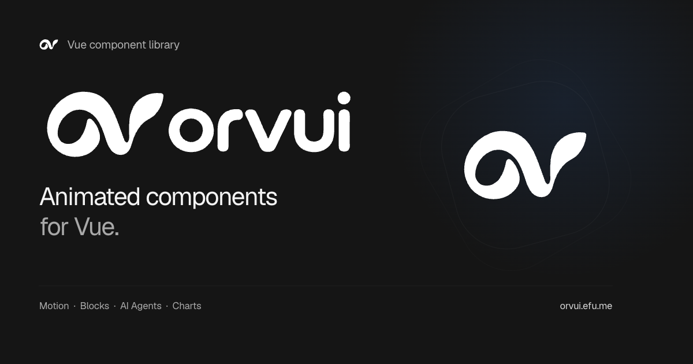

<h1 align="center">orvui</h1>

<p align="center">Animated components for Vue. Composable, customizable, with source you own.</p>

<p align="center">
  <a href="https://vuejs.org/"></a>
  <a href="https://www.typescriptlang.org/"></a>
  <a href="./LICENSE"></a>
</p>

<p align="center">
  <a href="https://orvui.efu.me/en/">Documentation</a> ·
  <a href="https://orvui.efu.me/en/components">Components</a> ·
  <a href="https://orvui.efu.me/en/templates">Templates</a> ·
  <a href="https://orvui.efu.me/en/docs/installation">Quick start</a>
</p>

<p align="center"><a href="./README.md">简体中文</a> · English</p>

<a href="https://orvui.efu.me/en/">
  
</a>

## Features

- **Components for everyday interfaces** — Animated controls, composed blocks, AI agent interfaces and charts, with interactive demos, usage examples and API documentation.
- **Customizable themes** — Eleven palettes, light and dark modes, and semantic CSS variables to match your product.
- **Responsive motion** — Shared springs and transitions that respect reduced-motion preferences.
- **Built for Vue** — Vue 3.5, the Composition API and TypeScript. Use explicit imports in Vue and Nuxt, install the package or copy individual component sources.

## Quick start

Use a Vue 3.5+ TypeScript project. See the [installation guide](https://orvui.efu.me/en/docs/installation) for environment requirements and complete setup.

### Install component source

Follow [source setup](https://orvui.efu.me/en/docs/installation#source-setup) to configure Tailwind CSS 4, the `@` alias and `components.json`, then add a component:

```sh
pnpm dlx shadcn-vue@2.8.2 add https://orvui.efu.me/r/button.json
```

Import Tailwind and the component theme in your application stylesheet (such as `src/style.css`), and ensure `src/main.ts` imports that stylesheet:

```css
@import "tailwindcss";
@import "./components/orvui/styles.css";
```

Use it in your page:

```vue
<script setup lang="ts">
import { Button } from "@/components/orvui/motion/button";
</script>

<template>
  <Button>Get started</Button>
</template>
```

Find installation commands for other components and variants on their [documentation pages](https://orvui.efu.me/en/components).

### Use the component package

The package includes compiled styles and requires no additional Tailwind setup. Install directly from npm; follow the [package guide](https://orvui.efu.me/en/docs/installation#package) for the complete setup.

```sh
pnpm add @orvui/vue
```

Pin version 0.1.1, or upgrade from 0.1.0:

```sh
pnpm add @orvui/vue@0.1.1
```

```vue
<script setup lang="ts">
import { Button } from "@orvui/vue/motion/button";
import "@orvui/vue/style.css";
</script>

<template>
  <Button>Get started</Button>
</template>
```

Import the package stylesheet once in your application entry. In Nuxt, load it through `css` in `nuxt.config.ts` and import components explicitly.

## Documentation

[Installation](https://orvui.efu.me/en/docs/installation) · [Theming](https://orvui.efu.me/en/docs/theme) · [Motion](https://orvui.efu.me/en/docs/motion-patterns) · [AI agent interfaces](https://orvui.efu.me/en/docs/ai-agents)

Explore [Motion](https://orvui.efu.me/en/components/motion), [Blocks](https://orvui.efu.me/en/components/blocks), [AI Agents](https://orvui.efu.me/en/components/agents) and [Charts](https://orvui.efu.me/en/charts), or try the [application templates](https://orvui.efu.me/en/templates).

## Local development

Use the pnpm version specified in `package.json` and run from the repository root:

```sh
pnpm install
pnpm docs:dev
```

Open the development URL printed by Nuxt. See the [docs README](./apps/docs/README.md) for build and validation commands.

## Contributing

Contributions to components, examples and documentation are welcome. Read the [contributing guide](./CONTRIBUTING.md) (Chinese) and [design contract](./design.md) first.

## License

Copyright (c) 2026 **everfu**. orvui project code is licensed under [MIT](./LICENSE).

Third-party code and assets retain their own copyright and terms. Paper Design shaders use a separate PolyForm Shield license, and fonts use SIL OFL. See [NOTICE](./NOTICE) for icon licenses and demo media sources.
